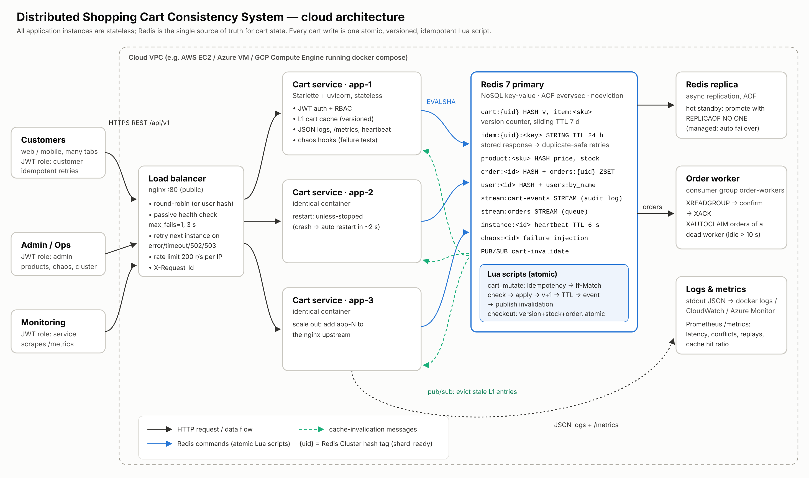

# Distributed Shopping Cart Consistency System

**Cloud Application and Development: individual project P57** · Aayush Singla · SAP 500121157 · Section B4
Category: Storage, Databases & Caching

A cloud cart service that keeps each shopping cart correct while it runs as **several stateless
instances behind a load balancer**, even when instances crash and clients send conflicting or
duplicate updates.



## What it demonstrates

| Problem in a multi-instance deployment | How this system prevents it | Measured result (naive → this design) |
|---|---|---|
| **Lost updates**: two instances read-modify-write the same cart | every change is one atomic Redis Lua script; relative adds use `HINCRBY` | 83–86 % of adds lost → **0** |
| **Blind overwrites**: two devices set different quantities | optimistic concurrency, `ETag` version + `If-Match` → `409` | 50/50 silent overwrites → **0** (all reported as 409) |
| **Duplicate application on retry** (client or LB retry) | `Idempotency-Key` stored atomically with the change | 200 duplicates → **0** (200 replays) |
| **Overselling** at checkout | stock check + decrement + order in one script | 15 units oversold → **0** |
| **Stale per-instance caches** | versioned L1 cache + pub/sub invalidation + `X-Min-Version` token | 66.7 % stale reads → **0 %** |
| **Instance crash** mid-request | stateless instances, LB retry, auto-restart, idempotent replay | 4 wrong units in 3 carts → **0** wrong carts (4 crashes, 28 LB retries) |
| **Worker crash** holding orders | Redis Streams consumer group + `XAUTOCLAIM` | 5 stuck orders recovered in 4.4 s |

Cache before/after (Redis 2 ms away): GET median latency **8.0 → 4.6 ms**, hit ratio **95 %** with user affinity.

## Stack

| Layer | Technology |
|---|---|
| API | Python 3.13, Starlette + uvicorn (ASGI), 18 REST endpoints under `/api/v1` |
| Auth | JWT (HS256) + RBAC roles `customer` / `admin` / `service`; scrypt password hashes |
| Database / cache / queue | Redis 7: hashes, Lua scripts, streams + consumer groups, pub/sub, TTLs; AOF persistence; async replica |
| Load balancer | nginx (round-robin, passive health checks, retry next upstream) |
| Deployment | Docker, docker compose (7 containers); runs on any cloud VM (see [DEPLOY](docs/DEPLOY.md)) |
| Observability | JSON logs with request ids, Prometheus `/metrics`, heartbeat-based cluster view |

## Repository layout

```
app/                 service code
  main.py            REST API, middleware (logs, metrics, errors), heartbeat, chaos hooks
  store.py           data access; ConsistentCartStore (the design) vs NaiveCartStore (baseline)
  lua/               cart_mutate.lua, checkout.lua: the atomic consistency logic
  auth.py            JWT + RBAC
  worker.py          order worker (Redis Streams consumer group, XAUTOCLAIM recovery)
  redis_client.py    small asyncio Redis client (RESP2, pool, pub/sub)
  seed.py            catalogue + admin/monitor accounts
deploy/              Dockerfile, nginx.conf, redis.conf, local cluster runner + LB
docker-compose.yml   full cloud stack
loadtest/            async load generator (low / medium / high workloads)
experiments/         correctness, failure, latency experiments; demo.sh; charts; results/*.json
tests/               integration tests (unittest)
docs/                API.md, openapi.yaml, SCHEMA.md, DEPLOY.md, architecture diagram, images
report/              final project report
```

## Quick start

**With Docker (cloud VM or laptop)**
```bash
cp .env.example .env            # set JWT_SECRET and REDIS_PASSWORD
docker compose up -d --build
docker compose exec app1 python -m app.seed
curl http://localhost/health
```

**Without Docker** (Python 3.11+ and `redis-server`)
```bash
pip install -r requirements.txt
deploy/local/cluster.sh start consistent 3        # LB on http://localhost:8080
python3 -m unittest -v tests.test_api             # 7 integration tests
experiments/demo.sh                               # full mandatory demonstration
experiments/run_all.sh                            # re-run every experiment + charts (~10 min)
deploy/local/cluster.sh stop
```

Default accounts after seeding: `admin / admin-pass-123` (admin), `monitor / monitor-pass-123` (service).
Change them with `ADMIN_PASSWORD` / `MONITOR_PASSWORD` before seeding a public deployment.

## Documentation
* [API documentation](docs/API.md) · [OpenAPI spec](docs/openapi.yaml)
* [Data model & sample records](docs/SCHEMA.md)
* [Deployment guide](docs/DEPLOY.md)
* [Final report](report/REPORT.md)
