# Distributed Shopping Cart Consistency System: Final Project Report

| | |
|---|---|
| Course | Cloud Application and Development: individual project |
| Project | **P57 · Distributed Shopping Cart Consistency System** · Category: Storage, Databases & Caching |
| Student | Aayush Singla · SAP 500121157 · Section B4 · Ayush.121157@stu.upes.ac.in |
| Repository | `dscart/` (Git, 12+ commits) · run everything with `experiments/run_all.sh` |

## 1. Summary

The system keeps every shopping cart correct while the cart service runs as **three stateless
instances behind a load balancer**, even when instances crash mid-request and clients send
conflicting or duplicate updates. All cart state lives in **Redis**. Every change is **one atomic Lua
script** that checks an idempotency key, checks the cart version (optimistic concurrency), applies the
change, bumps the version, renews the expiry, appends an audit event and publishes a cache
invalidation.

Against a typical "load the cart, modify it, save it" baseline, measured on the same 3-instance cluster:

| Incorrect result | Naive baseline | This design |
|---|---|---|
| Lost updates (600 concurrent adds to one cart) | 514 lost (85.7 %) | **0** |
| Units oversold (20 buyers, 5 in stock) | 15 | **0** |
| Stale reads from another instance's cache | 66.7 % | **0 %** |
| Duplicate adds from retried requests (200) | 200 | **0** |
| Silent overwrites of concurrent edits (50) | 50 | **0** (50 × `409`) |
| Wrong carts after 4 instance crashes under load | 3 carts / 4 units | **0** |

The consistency design costs no measurable throughput (≈ 940–980 req/s vs 990 req/s for the naive
version at medium/high load, both CPU-bound on a 2-vCPU host). With Redis one network hop away,
the versioned instance cache with user affinity cuts `GET /cart` median latency from **8.0 ms to 4.6 ms**
(95 % hit ratio).

## 2. Problem and objectives

E-commerce carts are written from several devices and tabs at once, and in the cloud each request may land on a
different application instance. Three things go wrong when cart state is handled per instance or with
read-modify-write:

1. **Conflicting updates.** Two instances read version *n*, both write *n+1*, and one change disappears.
2. **Instance failures.** An instance commits a change and dies before answering. The client or load balancer
   retries, and the change is applied twice.
3. **Stale caches.** Instance A caches the cart, instance B changes it, and A keeps serving the old cart.

Objectives: stateless horizontally-scaled instances; a single consistent store; atomic, versioned,
idempotent writes; bounded cache staleness; automatic recovery from instance and worker crashes; and
measurements proving each property against a baseline.

## 3. Cloud architecture


| Component | Technology | Role | Why it is needed |
|---|---|---|---|
| Load balancer | nginx 1.27 | round-robin (optional user-hash), passive health checks, retry on the next instance, rate limit | spreads load; hides instance failures from clients |
| Cart service × 3 | Python 3.13, Starlette, uvicorn, Docker | REST API, JWT/RBAC, versioned L1 cache, logs, metrics, heartbeat | stateless, so any instance can serve any user and instances can be added or killed |
| Redis 7 primary | Redis + Lua, AOF `everysec` | single source of truth: carts, idempotency records, products, orders, users; streams; pub/sub | atomic multi-step operations in one round trip |
| Redis replica | async replication | hot standby / read copy | survives loss of the primary (manual promote; automatic on managed Redis) |
| Order queue | Redis Streams + consumer group | decouples checkout from order processing | worker crashes do not lose orders |
| Order worker | Python | confirms orders, `XACK`, reclaims stuck orders with `XAUTOCLAIM` | asynchronous processing with at-least-once delivery + idempotent handling |
| Observability | JSON logs (stdout), Prometheus `/metrics`, heartbeats | events, failures, latency, conflicts, replays, cache hit ratio | requirement 6/7 + operating the system |

Request path: client → nginx → any instance → Redis Lua script (atomic) → response with `ETag`.
Each write publishes `user:version` on `cart-invalidate`, and every instance evicts older cached copies.

## 4. Storage, database and caching design and its justification

**Choice: Redis, a NoSQL in-memory key-value store, as the system of record for carts, with AOF persistence and a replica.**

| Criterion | Need of a cart | Redis (chosen) | PostgreSQL (SQL alternative) | DynamoDB / Cosmos (cloud NoSQL alternative) |
|---|---|---|---|---|
| Access pattern | always by user id, whole small cart | key lookup, O(1) | row lookup + join to lines | key lookup |
| Atomic multi-step logic | check key + version + stock, then write several keys | **Lua script = one atomic step, one round trip** | transaction with `SELECT … FOR UPDATE`, several round trips, lock waits | conditional writes per item; multi-item transactions limited and costly |
| Expiry of abandoned carts | yes | native per-key TTL | cron job + delete | native TTL |
| Latency | every page view | sub-millisecond | ms, more under lock contention | single-digit ms |
| Queue + cache invalidation | yes | Streams + Pub/Sub built in | needs extra broker (LISTEN/NOTIFY limited) | needs extra service |
| Durability | carts are important, not financial records | AOF every second (≤ 1 s exposure) + replica | strongest | strong |

Carts are short-lived, high-write and always accessed by key, so a relational schema adds joins and lock
contention without benefit. The decisive feature is **server-side atomic scripts**: the whole
"check-then-act" runs inside Redis, so no instance can interleave with another. Orders would move to a
relational database in a production system that needs accounting and reporting. Here they are kept in Redis
to show the full flow with one store (see Limitations).

**Caching.** Each instance keeps an L1 cache of carts keyed by user id and tagged with the version.
* Writes update the writer's cache and **publish** `user:version`; other instances evict any cached
  entry older than that version (pub/sub invalidation).
* `X-Min-Version` (read-your-writes token): a client sends the highest version it has seen and the instance
  bypasses the cache if its copy is older. This closes the small window while an invalidation is in flight.
* TTL of 30 s as a safety net; the whole cache is flushed when the pub/sub connection reconnects (messages may have been missed).
* The product catalogue is cached for 60 s and invalidated on admin updates. Stock is never trusted from the cache: it is
  checked atomically at checkout.

## 5. Data model

Full schema with sample records: [`docs/SCHEMA.md`](../docs/SCHEMA.md).

| Entity | Key / type | Important fields |
|---|---|---|
| Cart | `cart:{user_id}` HASH, TTL 7 days sliding | `v` version, `item:<sku>` quantity, `updated_at`, `updated_by` |
| Idempotency record | `idem:{user_id}:<key>` STRING, TTL 24 h | request fingerprint + stored response |
| Product | `product:<sku>` HASH | `name`, `price_cents` (integer money), `stock` |
| User | `user:<id>` HASH + `users:by_name` | `username`, `role`, `password_hash` (scrypt) |
| Order | `order:<id>` HASH + `orders:<user>` ZSET | `items` snapshot, `total_cents`, `status`, `cart_version`, `created_by`, `confirmed_by` |
| Audit / queue | `stream:cart-events`, `stream:orders` | one entry per change / per order |

Sample cart and its idempotency record (taken from the running system):
```
cart:{u_fd36fce56af6}   v 8 · item:SKU-CAP 4 · updated_by app-3 · TTL 604763 s
idem:{u_fd36fce56af6}:demo-checkout-01  dd12db687a762876|{"order_id":"o_48ece3c3c8f7","total_cents":599400,...}
```
One hash field per line means two devices adding different products touch different fields, and the same
product is a single `HINCRBY`. The `{user_id}` hash tag keeps a user's keys on one shard if Redis Cluster is used later.

## 6. Handling concurrency, expiry, versioning, duplicates and cache invalidation

| Concern | Mechanism | Where |
|---|---|---|
| Concurrency | the full check → apply → version → event sequence runs inside one Lua script; Redis executes scripts one at a time | `app/lua/cart_mutate.lua` |
| Versioning | `v` increments on every change and never goes back; returned as `ETag`; `If-Match` required for absolute writes (`PUT`, checkout) → `409` with current cart, `428` if missing | script + `app/main.py` |
| Merge-friendly adds | adds are relative (`HINCRBY`), so concurrent adds merge without conflicts | script |
| Duplicates | `Idempotency-Key` → stored result written in the same script; retry → replay with `Idempotent-Replayed: true`; key reused with a different body → `422` | script |
| Oversell | checkout checks stock of every line first, then decrements all, creates the order and empties the cart; any failure → nothing changes | `app/lua/checkout.lua` |
| Expiry | `PEXPIRE` 7 days on every write (abandoned carts disappear); idempotency records 24 h; heartbeats 6 s | scripts, heartbeat |
| Cache invalidation | versioned L1 cache + pub/sub + `X-Min-Version` + reconnect flush | `app/store.py`, `app/main.py` |
| Unique users | `HSETNX users:by_name` | `UserStore.create` |

## 7. REST API

18 endpoints under `/api/v1`. Full reference: [`docs/API.md`](../docs/API.md), OpenAPI: [`docs/openapi.yaml`](../docs/openapi.yaml).

| Method & path | Role | Purpose |
|---|---|---|
| `POST /auth/register`, `POST /auth/login` | public | account + JWT |
| `GET /products` · `POST /products` | public · admin | catalogue |
| `GET /cart` | customer | cart + `ETag` |
| `POST /cart/items` | customer | add quantity (idempotent) |
| `PUT /cart/items/{sku}` | customer | set quantity (`If-Match` required) |
| `DELETE /cart/items/{sku}`, `DELETE /cart` | customer | remove line / clear |
| `POST /cart/checkout` | customer | atomic checkout (`If-Match` required) |
| `GET /orders`, `GET /orders/{id}` | customer | orders |
| `GET /admin/cluster`, `/admin/events`, `/admin/carts/{id}` | admin, service | live instances, audit stream, raw storage state |
| `POST /admin/chaos` | admin | failure injection |
| `GET /health`, `GET /metrics` | public | health check, Prometheus metrics |

**Authentication and authorisation.** HS256 JWT (1 h, issuer-checked) obtained from login;
passwords stored as scrypt hashes. RBAC roles: `customer` (own cart and orders only), `admin` (catalogue,
chaos, cluster views), `service` (read-only operational views for monitoring). Verified by the integration
tests (`tests/test_api.py`: `401` without/with a tampered token, `403` for customers on admin routes, `403` for
the service role on chaos).

## 8. Logging and metrics

Every log line is JSON with timestamp, level, instance and event. Events logged: every HTTP request (method,
path, status, latency, request id, replay flag), `cart_item_added/set/removed`, `checkout_ok`,
`version_conflict`, `login_ok/failed`, `user_registered`, `product_upserted`, `chaos_*`,
`instance_started/stopped`, `storage_unavailable`, `heartbeat_failed`, worker `order_confirmed`,
`order_reclaimed`, `worker_chaos_crash`; plus load-balancer `upstream_failed_retrying` and supervisor
restarts. Prometheus metrics: request counts and latency histograms per route, version conflicts,
idempotent replays, cache hits/misses/invalidations, orders, out-of-stock rejections, storage errors.

**Metrics used in this report:** (1) p50/p95/p99 latency, (2) throughput, (3) lost-update / duplicate / oversell
counts, (4) stale-read rate, (5) cache hit ratio, (6) recovery time after a crash.

## 9. Deployment

`docker-compose.yml` defines seven containers (nginx, app1–3, worker, redis, redis-replica). Instances use
`restart: unless-stopped` and a health check on `/health`. Secrets come from `.env`. Step-by-step guide for an AWS EC2 VM (and
Azure/GCP), plus the managed-service mapping (ALB, ECS/Fargate, ElastiCache): [`docs/DEPLOY.md`](../docs/DEPLOY.md).

The experiments below were run on the **same topology started without Docker** (`deploy/local/cluster.sh`:
Redis primary + replica, three uvicorn instances under a restart supervisor, the order worker, and a load
balancer that reproduces the nginx configuration: round-robin, `max_fails=1 fail_timeout=3s`, retry on next
upstream). Host: 2 vCPU, 7 GB RAM, Python 3.13, Redis 7.0. All components and the load generator share
those 2 vCPUs, so absolute throughput is CPU-bound. The comparisons are what matter.

## 10. Experiments and results

All raw results are in `experiments/results/*.json` and reproducible with `experiments/run_all.sh`.
Three configurations were compared:
* **Naive + instance cache**: read cart (from the instance's own cache if present), modify in Python, save the whole cart. No versions, no idempotency, no invalidation.
* **Naive, no cache**: same but always reads from Redis (isolates race and retry effects from cache staleness).
* **Consistent**: the design described above.

### 10.1 Correctness: cases where the storage design prevents an incorrect result (req. 13)

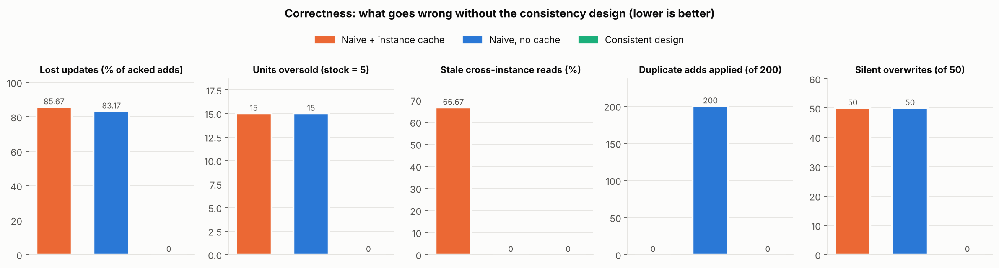

| Experiment | Setup | Naive + cache | Naive, no cache | Consistent |
|---|---|---|---|---|
| E1 lost updates | 30 clients × 20 "+1" adds to the **same** cart via the LB | stored 86 of 600 (85.7 % lost) | 101 of 600 (83.2 % lost) | **600 of 600** |
| E2 overselling | 20 buyers check out the last 5 units concurrently | 20 orders, 15 oversold, final stock 2 (also wrong) | 20 orders, 15 oversold | **5 orders, 15 × 409 OUT_OF_STOCK, stock 0** |
| E3 stale reads | write via one instance, read immediately via another (300×) | 200 stale (66.7 %) | 0 | **0** (0 also with token) |
| E4 duplicate retries | each add sent twice with the same key, 2nd to another instance (200×) | 134 stored (losses hide duplicates) | **400 stored (200 duplicates)** | **200 stored, 200 replays** |
| E5 concurrent edits | two devices `PUT` different quantities with the same `If-Match` (50×) | 50 silent overwrites | 50 silent overwrites | **0; 50 × 409 conflict** |

Why the baseline fails: in E1 two instances read quantity *q* and both write *q+1*. In E2 each instance checks
"stock ≥ 1" before any of them decrements. In E4 nothing tells the second request that the first one
already happened. The consistent design removes the gap between "check" and "act" by running both inside
one Redis script.

Screenshot: concurrent edit rejected with `409`, absolute write without version refused with `428`:

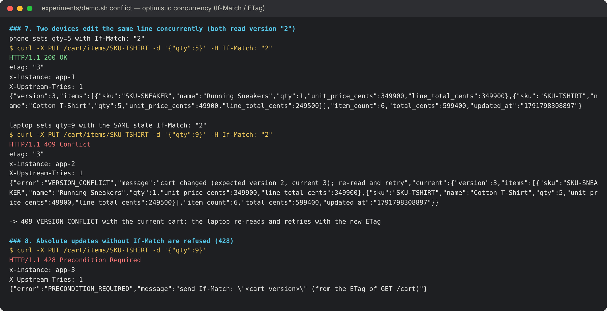

Screenshot: atomic checkout, asynchronous confirmation by the worker, and the oversell race:

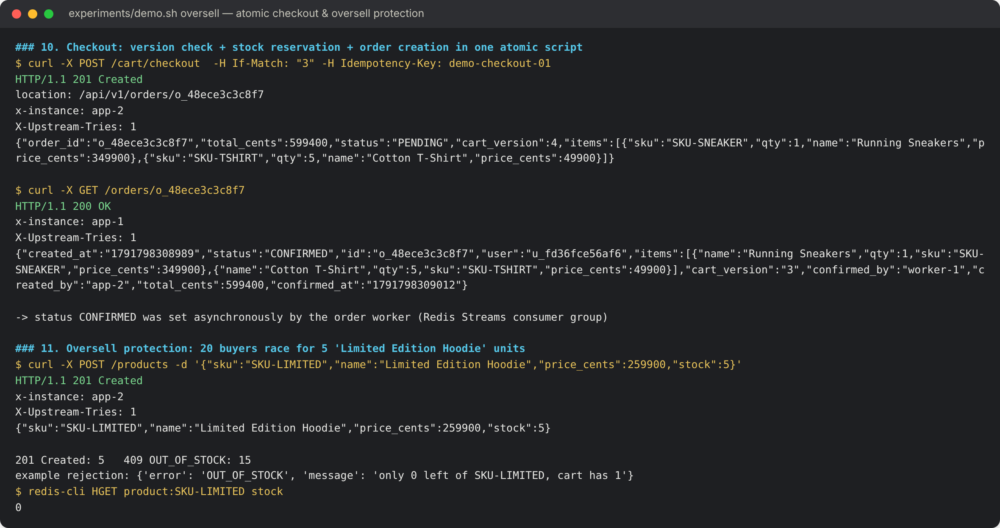

### 10.2 Controlled failure scenario and recovery (common req. 5)

**Scenario.** 20 users add items continuously for 35 s (every add carries an Idempotency-Key; clients retry
failed requests with the same key). At t = 8 s app-2 is switched to `crash_after_commit` (p = 0.25) for 8 s:
it **commits the change in Redis and then exits before answering**, the worst case for duplicates. At
t = 20 s app-3 is killed with SIGKILL. A supervisor (Docker's `restart: unless-stopped` locally)
restarts crashed instances after 2 s.

**Recovery mechanism.**
1. The load balancer sees the dropped connection, marks the instance down for 3 s and **retries the same request on another instance**. This is configured for POST too (`non_idempotent`), which is only safe because of step 2.
2. The retried request carries the same Idempotency-Key, so the Lua script finds the stored result and **replays it instead of applying the add again**.
3. Instances are stateless, so nothing is lost with the process; the restarted instance rejoins after its health check, and its heartbeat reappears in `/admin/cluster`.
4. The restarted instance starts with an empty cache, so it cannot serve stale data.

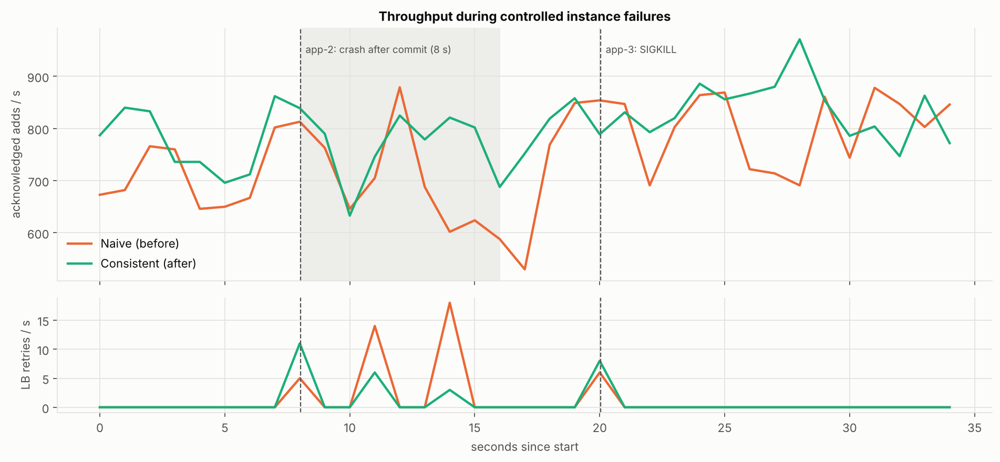

| Result (35 s, 4 instance crashes) | Naive (no cache) | Consistent |
|---|---|---|
| Adds acknowledged to clients | 26 156 | 28 093 |
| Units stored in Redis | 26 160 | 28 093 |
| Carts with a wrong quantity | **3 (4 duplicated units)** | **0** |
| Requests retried by the LB | 43 | 28 |
| Retries answered by idempotent replay | 0 | 11 |
| Requests that failed for the client | 0 | 0 |
| app-3 back in rotation after SIGKILL | 3.1 s | 3.09 s |

Both versions stay available. Only the consistent design stays **correct**: with the naive one every
crash-after-commit followed by a retry adds the item twice.

**Order-worker failure.** A worker read 5 orders and crashed on the first (exit 17), leaving all 5 in the
consumer group's pending list with status `PENDING`. A second worker reclaimed them with `XAUTOCLAIM`
(idle > 3 s) and confirmed all 5 in **4.4 s**; pending list back to 0. The worker checks the status
before confirming, so a reclaimed order is never processed twice.

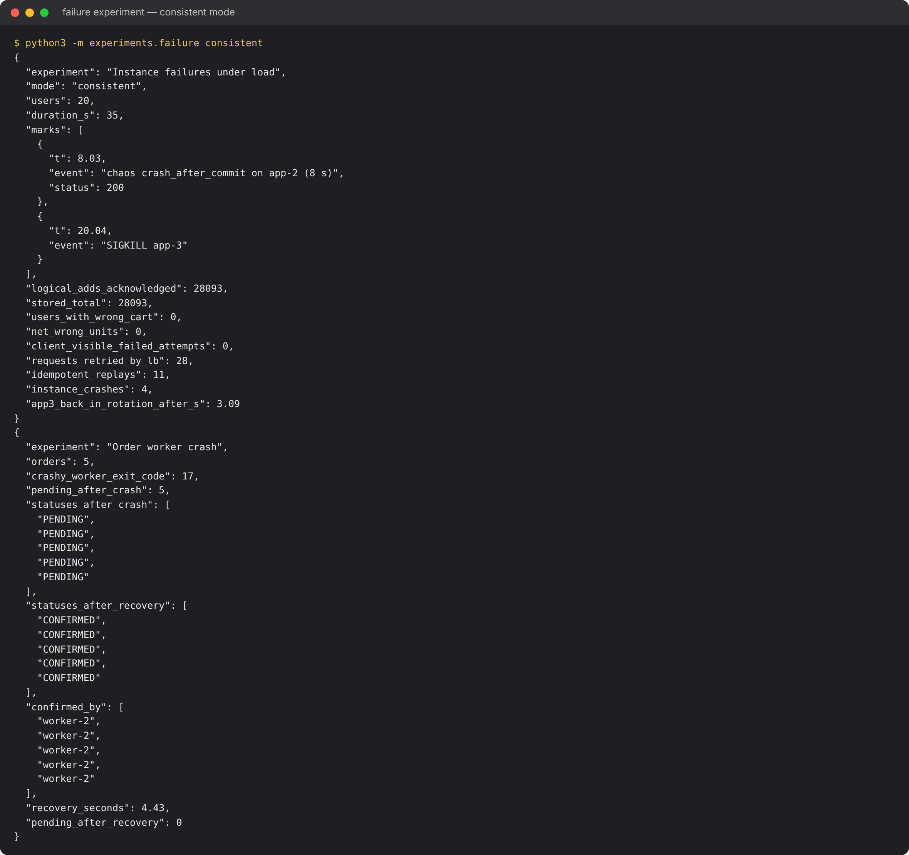

### 10.3 Load testing at low, medium and high workload (req. 8)

Closed-loop load generator, each virtual user with its own account. Mix per request: 50 % `GET /cart`, 30 % add,
10 % set (with `If-Match`), 5 % remove, 5 % checkout. 20 s per level.

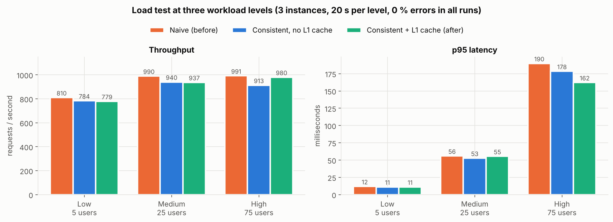

| Configuration | Level (users) | Requests | Throughput (req/s) | p50 ms | p95 ms | p99 ms | 5xx / errors |
|---|---|---|---|---|---|---|---|
| Naive + cache (before) | low (5) | 16 204 | 809.9 | 5.41 | 11.86 | 18.91 | 0 % |
| | medium (25) | 19 816 | 989.9 | 21.12 | 55.93 | 93.36 | 0 % |
| | high (75) | 19 902 | 991.4 | 59.44 | 189.84 | 282.62 | 0 % |
| Consistent, no L1 cache | low (5) | 15 680 | 783.8 | 5.91 | 11.19 | 14.84 | 0 % |
| | medium (25) | 18 825 | 940.4 | 24.17 | 52.76 | 67.06 | 0 % |
| | high (75) | 18 324 | 913.1 | 73.12 | 178.47 | 236.25 | 0 % |
| Consistent + L1 cache (after) | low (5) | 15 579 | 778.7 | 6.03 | 11.11 | 14.09 | 0 % |
| | medium (25) | 18 749 | 936.8 | 23.94 | 55.35 | 71.85 | 0 % |
| | high (75) | 19 658 | 979.9 | 68.12 | 162.20 | 196.07 | 0 % |

Observations:
* Throughput saturates at ≈ 950–990 req/s. This is the CPU limit of the 2-vCPU host running all components.
  From medium to high load only latency grows, which is the expected queueing behaviour of a saturated system.
  Requests are spread evenly (≈ ⅓ per instance).
* No errors at any level; version conflicts 0 % (each user is one client in this test).
* The consistent design is as fast as the naive one: one Lua round trip replaces the naive version's two or three
  round trips. The naive version's slightly higher throughput comes partly from serving stale cached carts
  (99 % "hit" ratio, but 66.7 % of cross-instance reads stale in E3).
* At high load the L1 cache reduces p99 from 236 ms to 196 ms.

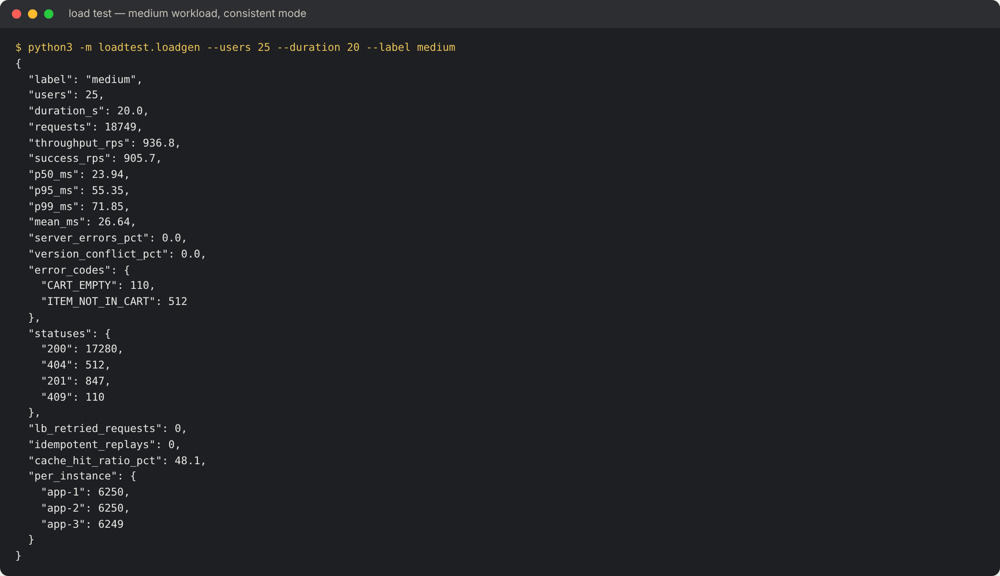

### 10.4 Performance before vs after the caching strategy (req. 14)

On one host Redis answers in microseconds, which hides the value of a cache. In a cloud deployment managed Redis
is a network hop away, so this experiment adds **+1 ms each way (2 ms RTT)** between the instances and Redis
(`experiments/latency_proxy.py`).

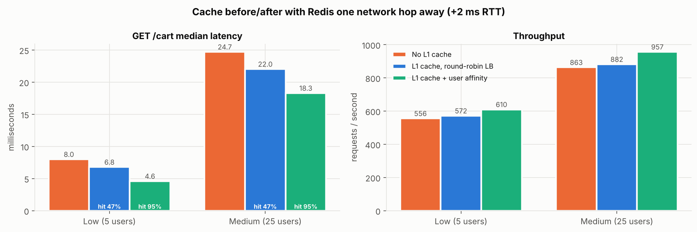

| Configuration (Redis +2 ms RTT) | Users | GET p50 ms | Overall p99 ms | Throughput req/s | Cache hit ratio |
|---|---|---|---|---|---|
| No L1 cache (before) | 5 | 7.99 | 16.63 | 555.5 | – |
| L1 cache, round-robin LB | 5 | 6.78 | 18.35 | 571.5 | 47.3 % |
| L1 cache + user affinity (after) | 5 | **4.59** | 19.96 | **609.7** | **95.1 %** |
| No L1 cache (before) | 25 | 24.71 | 67.99 | 863.3 | – |
| L1 cache, round-robin LB | 25 | 22.03 | 67.80 | 881.9 | 47.0 % |
| L1 cache + user affinity (after) | 25 | **18.29** | **57.44** | **956.7** | **94.8 %** |

With round-robin a user's next request usually reaches an instance whose copy was just invalidated, so the
hit ratio stays near 47 %. Routing each user to the same instance (`hash $http_authorization consistent` in
nginx) raises it to 95 %. Cart reads get **43 % faster** at low load and throughput rises **11 %** at medium load.
Correctness never depends on affinity: if the user's instance dies, another instance serves them, and
versioned invalidation plus `X-Min-Version` still prevent stale reads.

## 11. Mandatory demonstration (screenshots)

`experiments/demo.sh` runs the whole demonstration against a running cluster (local or cloud). Each section can
also be run alone (`demo.sh api|conflict|redis|oversell|failure|metrics|logs`).

**API execution** through the load balancer (instances rotate), idempotent replay, RBAC:
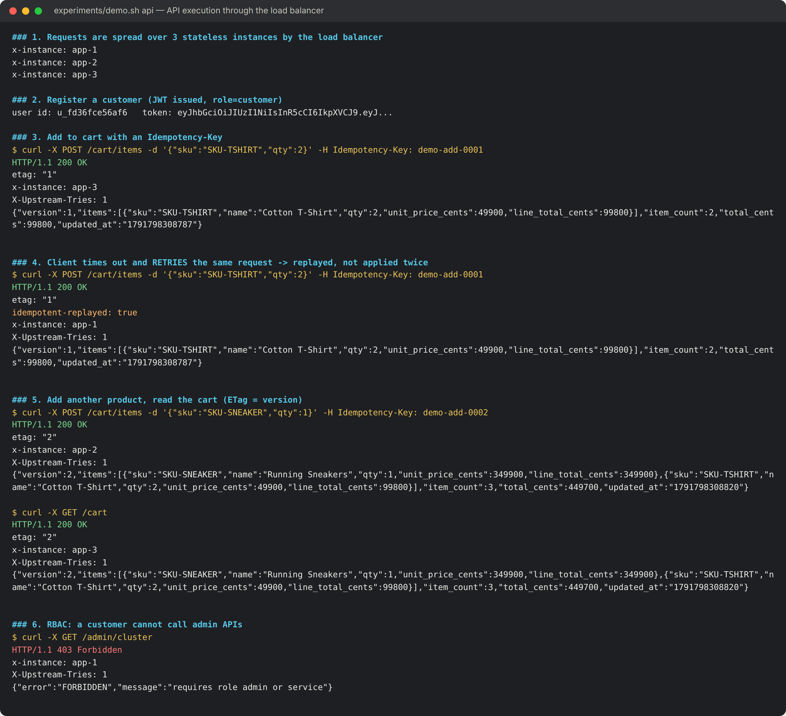

**Database/storage state** in Redis: cart hash with version and TTL, idempotency record, audit stream:
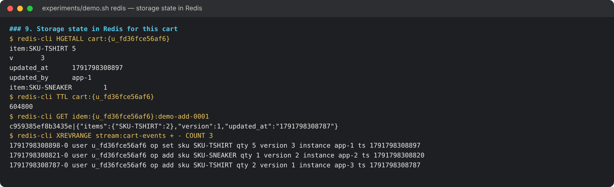

**Failure handling:** app-2 crashed through the chaos API, request retried by the LB (`X-Upstream-Tries: 2`), instance restarted and back in the cluster view:
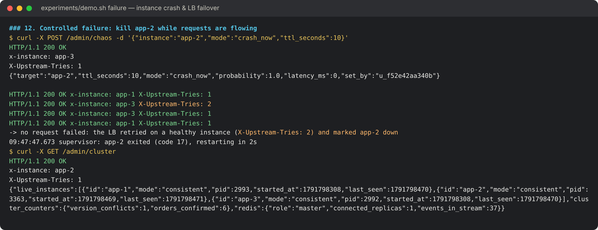

**Metrics** from all instances and the audit trail:
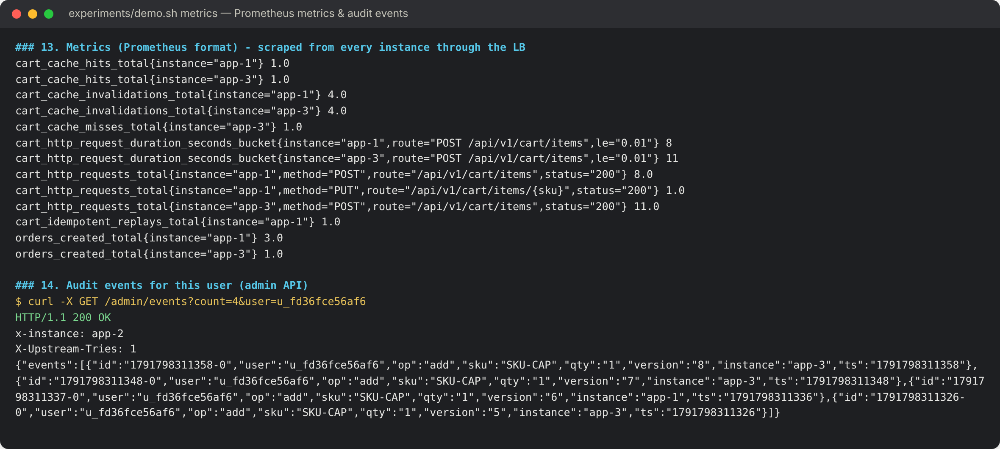

**Logs:** replay, version conflict, LB failover, supervisor restart:
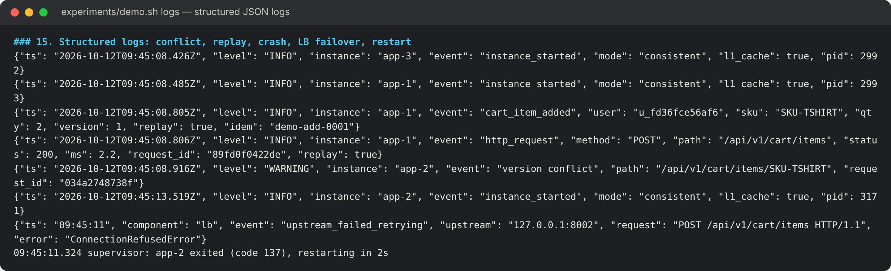

## 12. Requirement compliance

| # | Requirement | Where it is met |
|---|---|---|
| P1 | Cart state across instances, failures, conflicts | §4, §6, §10.1, §10.2 |
| P2 / C1 | ≥ 5 meaningful REST endpoints | 18 endpoints, §7, `docs/API.md` |
| P3 | Data model | §5, `docs/SCHEMA.md` |
| P4 / C3 | Authentication / authorisation | JWT + RBAC (3 roles), §7, tests |
| P5 | Deploy on a cloud/deployable environment | Docker image + compose stack + EC2 guide, §9, `docs/DEPLOY.md` |
| P6 / C7 | Logs for events, failures, actions | JSON logs, §8, logs screenshot |
| P7 / C7 | ≥ 2 metrics | 6 metrics, §8, §10 |
| P8 / C6 | Load test at 3 levels | §10.3 |
| P9 / C8 | Architecture diagram | §3, `docs/img/architecture.png` |
| P10 / C10 | API docs, report, screenshots, results | `docs/API.md`, `openapi.yaml`, this report, §10–11 |
| P11 / C2 | Justify storage/database (SQL vs NoSQL) | §4 |
| P12 | Concurrency, expiry, versioning, duplicates, invalidation | §6 |
| P13 | Storage design prevents an incorrect result | §10.1 (five cases) |
| P14 | Before/after comparison | §10.1, §10.2, §10.3, §10.4 |
| P15 | Sample records and schema explanation | §5, `docs/SCHEMA.md` |
| C4 | ≥ 3 cloud components | LB, 3 instances, Redis primary + replica, Streams queue, worker, observability (§3) |
| C5 | Controlled failure + recovery | §10.2 |
| C9 | Git repo, ≥ 8 meaningful commits | 12+ commits (`git log`) |
| C11 | Viva / live modification | `tests/test_api.py` (7 tests) and `experiments/demo.sh` to verify a change quickly |

## 13. Limitations and future work

* **Single Redis primary.** Failover to the replica is manual here (`REPLICAOF NO ONE`). Replication is
  asynchronous, so up to about 1 s of writes could be lost. A managed Redis with Multi-AZ automatic failover
  (ElastiCache, Azure Cache) or Redis Sentinel removes the manual step. The `{user_id}` hash tags already make
  the keys ready for Redis Cluster sharding.
* **Orders in Redis.** A production system would also write orders to a relational database (via the
  `stream:orders` queue) for reporting and accounting.
* **Measurement host.** All experiments ran on a 2-vCPU host shared by every component. A cloud run with
  separate VMs would show higher absolute throughput; the relative results are what this report relies on.
* **Catalogue cache.** `GET /products` can show stock up to 60 s old. This is acceptable because stock is
  enforced atomically at checkout.
* Future work: guest-cart merge at login, cart events into analytics (abandoned-cart emails from the expiry
  notifications), HTTPS termination with a certificate at the load balancer.

## 14. Conclusion

Correct shopping-cart behaviour across multiple cloud instances comes from the storage design rather than
from the application instances. Stateless instances, a single atomic store, version checks and idempotency
keys together turned five classes of real errors (lost updates, overselling, stale reads, duplicates and
silent overwrites) into zero in every experiment, including under repeated instance crashes. The
throughput cost was not measurable, and a versioned, invalidated cache recovered read latency when the
database was a network hop away.
